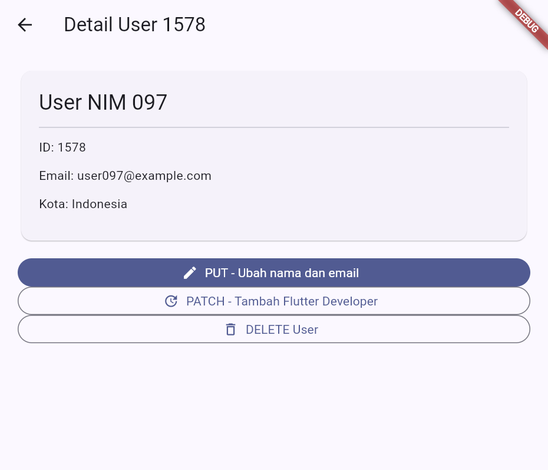
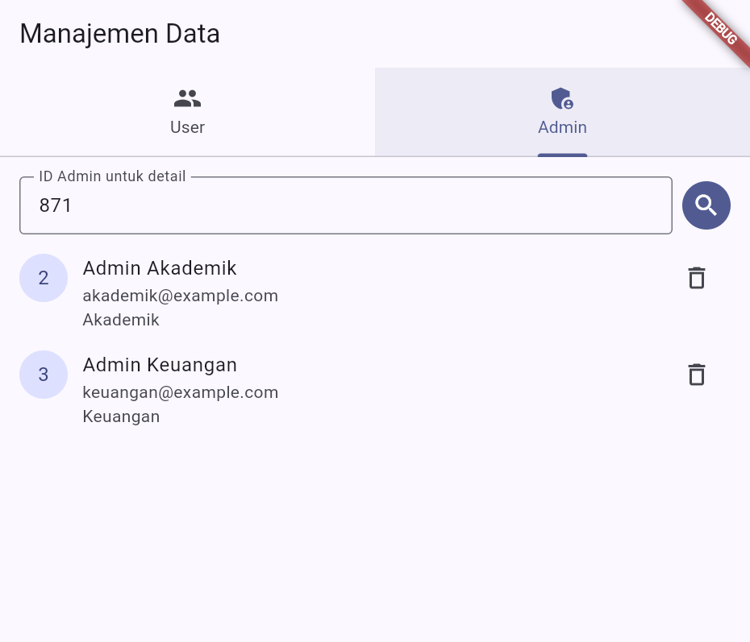

# Laporan Praktikum: Pengelolaan User dan Admin

## Identitas NIM

Tiga digit terakhir NIM adalah `097`. Angka tengah dipindahkan ke belakang sehingga
`N = 079` (nilai numerik 79). Dengan demikian:

- ID User: `1499 + 79 = 1578`
- ID Admin: `792 + 79 = 871`

## Struktur dan implementasi

- `lib/models/user_model.dart`: Model User dengan properti `id`, `name`, `email`,
  dan `city`, termasuk konversi JSON.
- `lib/services/user_service.dart`: `ApiService` menangani GET daftar/detail,
  POST, PUT, PATCH, dan DELETE User. Data User disimpan secara lokal; GET pertama
  mencoba JSONPlaceholder dan memakai data cadangan saat layanan tidak tersedia.
  POST memakai ID 1578.
- `lib/models/admin.dart`: Model Admin dengan properti `id`, `name`, `email`,
  dan `department`, serta `fromJson()` dan `toJson()`.
- `lib/services/admin_service.dart`: GET semua/detail Admin dan DELETE Admin.
  Data disimpan di SharedPreferences; data awal menyediakan Admin ID 871 agar
  fitur detail dan penghapusan sesuai identitas praktikum.
- `lib/main.dart`: Tampilan tab User dan Admin, daftar, pencarian detail melalui
  ID, penambahan/perubahan/penghapusan User, dan penghapusan Admin.

## Hasil pengujian

Pengujian otomatis memeriksa konversi JSON Admin, GET daftar/detail dan DELETE
Admin ID 871, serta POST, PUT, PATCH, dan DELETE User (termasuk ID 1578 dan
akhiran nama `- Flutter Developer`). Daftar Admin juga diuji melalui widget.
Semua tes lulus dan `flutter analyze` tidak menemukan masalah. Jalankan
`flutter test` untuk mengulang pengujian. Tampilan dapat dijalankan dengan
`flutter run`.

## Bukti screenshot

- User ID 1578: 
- Daftar Admin setelah penghapusan ID 871:
  

> Catatan: Admin memakai penyimpanan lokal aplikasi karena tugas tidak
> menentukan endpoint Admin. Data awal dan penghapusan tetap tersimpan setelah
> aplikasi dibuka ulang pada perangkat yang sama.
